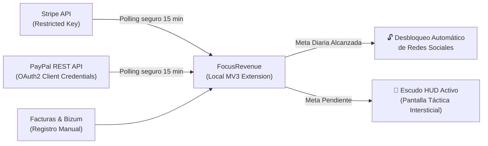

# FocusRevenue — Bloqueador de Distracciones por Meta Diaria de Facturación

[](https://github.com/moradotheone/focus-revenue-blocker)
[](https://developer.chrome.com/docs/extensions/mv3/)
[](LICENSE)
[](https://github.com/moradotheone/focus-revenue-blocker)
[](docs/PRD_AND_HANDOVER.md)

> **"El cortafuegos que bloquea tus distracciones hasta que entre dinero en tu cuenta."**  
> FocusRevenue es una extensión de Google Chrome (Manifest V3) inspirada en la telemetría y diseño de **SpaceX / Starlink** que vincula el desbloqueo de redes sociales y entretenimiento a tu **meta económica diaria de facturación**.

---

## 📌 Documentación de Producto y Handover

Para especificaciones detalladas, arquitectura, copys de landing y guía técnica completa:
* 📄 **[PRD & Handover Técnico Completo](docs/PRD_AND_HANDOVER.md)**: Requerimientos funcionales, arquitectura MV3, esquema de datos, seguridad zero-PII y roadmap de sprints.
* 🚀 **[Landing Page Copy & Product Pitch](docs/LANDING_COPY.md)**: Textos de alta conversión listos para landing page, tienda web, anuncios y lanzamientos en español e inglés.

---

## 🎯 ¿Por Qué FocusRevenue?

Los bloqueadores de pantalla tradicionales (Pomodoro, Freedom, StayFocusd) fallan porque la fuerza de voluntad se agota a las 11:00 AM y el cerebro sabe que puede apagarlos sin consecuencias. 

FocusRevenue cambia las reglas:
1. **Bloqueo a nivel de red (`declarativeNetRequest`):** A las 08:00 AM, tus redes y webs de ocio quedan selladas a nivel de conexión.
2. **Auditoría automática de ingresos:** Conexión nativa de solo lectura con **Stripe** y **PayPal**.
3. **Desbloqueo reactivo inmediato:** En cuanto un cliente te paga o facturas tu objetivo diario (ej. 200 €), el escudo se baja solo. Tu dopamina queda alineada con la supervivencia y crecimiento de tu negocio.
4. **Salida ética de emergencia:** Si necesitas consultar un vídeo de soporte o resolver una urgencia, dispones de un bypass temporal con registro de motivo sin coerción.

---

## ⚡ GUÍA DE AUTOINSTALACIÓN RÁPIDA (Chrome, Brave, Edge)
> *Mientras se completa la publicación oficial en el Chrome Web Store, puedes instalar y ejecutar FocusRevenue en menos de 1 minuto:*

### Paso 1: Obtener el Código
- **Opción A (Recomendada - ZIP):**  
  Descarga el archivo ZIP oficial: **[Descargar focus-revenue-mvp-v0.zip](https://github.com/moradotheone/focus-revenue-blocker/archive/refs/heads/main.zip)** y descomprímelo.
- **Opción B (Git):**  
  ```bash
  git clone https://github.com/moradotheone/focus-revenue-blocker.git
  ```

### Paso 2: Cargar la Extensión en el Navegador
1. Abre tu navegador y accede a:
   - **Google Chrome:** `chrome://extensions`
   - **Brave Browser:** `brave://extensions`
   - **Microsoft Edge:** `edge://extensions`
2. Activa la casilla **«Modo de desarrollador»** (esquina superior derecha).
3. Haz clic en **«Cargar descomprimida»** (*Load unpacked*).
4. Selecciona la carpeta del proyecto (`focus-revenue-blocker`).
5. **¡Listo!** Te recomendamos anclar el icono en la barra superior para ver el HUD en todo momento.

---

## 💳 Conexión Oficial con Pasarelas (Stripe & PayPal)



* **Stripe:** Introduce tu *Restricted Key* de solo lectura (`rk_live_...` con permisos `charges:read` e `invoices:read`).
* **PayPal:** Introduce tus credenciales OAuth2 (*Client ID* y *Secret*) en modo Live o Sandbox.
* **Sincronización Periódica:** Cada 15 minutos, el service worker recalcula tus ingresos y desactiva el escudo automáticamente al alcanzar la meta.

---

## 🔒 Privacidad y Seguridad (Zero-PII)

* **Cero intermediarios:** Todas las peticiones van directamente desde tu navegador a `api.stripe.com` o `api.paypal.com`.
* **Cero recolección de PII:** Jamás se almacenan ni transmiten nombres de compradores, números de tarjeta o datos personales.
* **Claves locales:** Tus API keys residen cifradas en `chrome.storage.local`.
* **Marco ético:** No es una herramienta clínica ni realiza afirmaciones médicas sobre TDAH. Es un framework de autodisciplina operativa.

---

## 🖥️ Módulos de la Interfaz (SpaceX / Starlink HUD)

1. **HUD Popup (`src/popup/`):** Medidor láser en tiempo real, inyector de ventas manuales y acceso a anulación de emergencia.
2. **Escudo Intersticial (`src/blocked/`):** Pantalla táctica con citas motivacionales, delta económico restante y desbloqueo inmediato.
3. **Mission Control (`src/dashboard/`):**
   * **01 Telemetría:** Indicadores de facturación diaria, progreso de meta y gráficos de rendimiento.
   * **02 Pasarelas & Facturas:** Configuración de Stripe y PayPal, auditoría anti-duplicados e inyector de pruebas.
   * **03 Escudo de Foco:** Gestión de lista negra de dominios bloqueados.
   * **04 Anulación de Emergencia:** Historial de desvíos temporales y justificaciones.
   * **05 Modelo Comercial:** Simulación de cobro del 3% por éxito y configuración de compromiso/penalización voluntaria.

---

## 🧪 Pruebas Automatizadas

```bash
# Tests unitarios del motor de facturación
node tests/test_billing.js

# Tests de integración de pasarelas Stripe y PayPal
node tests/test_payments.js
```

Para previsualizar las pantallas en tu navegador local sin instalar la extensión:
```bash
npm run preview
# Accede a http://localhost:3000/test-preview/
```

---

## 📄 Licencia

Desarrollado bajo licencia MIT por Jorge Morado (`jorge@morado.one`). Ver [LICENSE](LICENSE) para más detalles.
