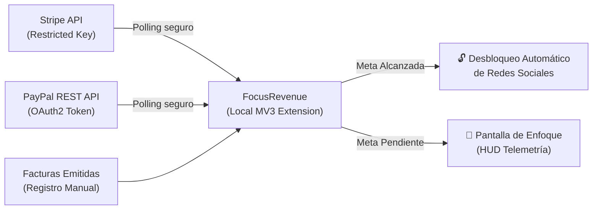

# FocusRevenue — Bloqueador de Distracciones por Meta Diaria de Facturación

[](https://github.com/moradotheone/focus-revenue-blocker)
[](https://developer.chrome.com/docs/extensions/mv3/)
[](LICENSE)
[](https://github.com/moradotheone/focus-revenue-blocker)

Extensión de navegador bajo estándar **Chromium Manifest V3** con diseño minimalista inspirado en la telemetría de **SpaceX / Starlink**. Vincula el acceso a redes sociales y entretenimiento digital a tu **meta económica diaria de facturación**.

---

## ⚡ GUÍA DE AUTOINSTALACIÓN RÁPIDA (Chrome, Brave, Edge)
> *Nota: Mientras se completa el proceso de validación y publicación en Chrome Web Store (Google Marketplace), puedes autoinstalar y utilizar FocusRevenue de forma instantánea mediante estos sencillos pasos:*

### Paso 1: Obtener el Código
Elige una de las dos opciones:

- **Opción A (Recomendada - Sin terminal):**  
  Descarga el archivo ZIP oficial del proyecto y descomprímelo en tu equipo:  
  👉 **[Descargar focus-revenue-mvp-v0.zip](https://github.com/moradotheone/focus-revenue-blocker/archive/refs/heads/main.zip)**

- **Opción B (Vía Git):**  
  ```bash
  git clone https://github.com/moradotheone/focus-revenue-blocker.git
  ```

---

### Paso 2: Cargar la Extensión en tu Navegador (30 Segundos)

1. Abre tu navegador basado en Chromium y dirígete a la gestión de extensiones:
   - **Google Chrome:** `chrome://extensions`
   - **Brave Browser:** `brave://extensions`
   - **Microsoft Edge:** `edge://extensions`
   - **Opera:** `opera://extensions`

2. Activa el interruptor **«Modo de desarrollador»** (situado en la esquina superior derecha).

3. Haz clic en el botón **«Cargar descomprimida»** (*Load unpacked*).

4. Selecciona la carpeta donde descargaste el proyecto (por ejemplo `focus-revenue-blocker`).

5. **¡Listo!** Verás la extensión activa. Te recomendamos **fijar el icono** (icono de chincheta/pin) en la barra superior para tener la telemetría de ingresos siempre a la vista.

---

## 💳 Conexión Oficial con Stripe y PayPal

FocusRevenue incluye una capa de integración directa con las APIs oficiales de **Stripe** y **PayPal**:



### 1. Stripe (Cobros con Tarjeta)
- Ve a tu panel de Stripe > *Developers* > *API Keys* > *Create restricted key*.
- Asígnale permisos de solo lectura (**Read**) sobre:
  - `Charges` (`read`)
  - `Invoices` (`read`)
- Pega tu clave (`rk_live_...` o `rk_test_...`) en la pestaña **02 PASARELAS & FACTURAS** de FocusRevenue y pulsa **Probar Conexión**.

### 2. PayPal (Transferencias y Pagos Recibidos)
- Ve a [developer.paypal.com](https://developer.paypal.com) > *Apps & Credentials*.
- Crea una aplicación y copia el **Client ID** y **Client Secret**.
- Soporta tanto entorno **Live (Producción)** como **Sandbox (Pruebas)**.

### 3. Sincronización Automática en Segundo Plano
- El service worker consulta automáticamente cada 15 minutos (configurable) tus cobros del día.
- En cuanto entra un nuevo pago en Stripe o PayPal, el medidor de ingresos se actualiza automáticamente y, si se alcanza el objetivo diario, **las barreras de distracción se desactivan solas**.

---

## 🔒 Privacidad Estricta y Seguridad de Datos

- **Cero intermediarios:** Todas las llamadas a las APIs de Stripe y PayPal se ejecutan directamente desde tu navegador hacia `api.stripe.com` y `api.paypal.com`.
- **Cero retención de PII:** La extensión jamás lee, almacena ni transmite números de tarjeta, cuentas bancarias, correos o datos personales de tus clientes compradores.
- **Almacenamiento Local Aislado:** Todas las configuraciones y credenciales se guardan localmente en `chrome.storage.local`.
- **Salida de Emergencia Sin Coerción:** Incorpora un protocolo de anulación de emergencia (5 a 20 min) para que nunca te quedes bloqueado ante una urgencia real o comunicación de soporte.

---

## 🖥️ Módulos de la Interfaz (SpaceX / Starlink HUD)

1. **HUD Popup (`src/popup/`):**
   - Medidor láser de ingresos diarios en tiempo real.
   - Inyector manual de cobros rápidos (`+50 STRIPE`, `+30 PAYPAL`, `+100 FACTURA`).
   - Botón de anulación inmediata de emergencia.
   - Enlace directo a Mission Control.

2. **Escudo Intersticial de Foco (`src/blocked/`):**
   - Pantalla cinematográfica que interrumpe la navegación en sitios de ocio configurados (Twitter/X, YouTube, Reddit, Instagram, etc.).
   - Visualización del delta económico pendiente para liberar el acceso.
   - Entrada rápida para registrar cobros y continuar navegando inmediatamente.

3. **Mission Control Dashboard (`src/dashboard/`):**
   - **01 Telemetría:** Resumen del día, objetivos editables, métricas y desglose de fee comercial (3%).
   - **02 Pasarelas & Facturas:** Configuración de claves Stripe y PayPal, simulador de webhooks y control de riesgo de doble conteo.
   - **03 Escudo de Foco:** Gestión de sitios bloqueados y alta de dominios personalizados.
   - **04 Anulación de Emergencia:** Registro histórico de desvíos temporales utilizados.
   - **05 Modelo Comercial:** Simulación de fee del 3% y experimento opcional de penalización voluntaria.

---

## 🧪 Pruebas Unitarias y Validación

El proyecto cuenta con una suite de pruebas automatizadas:

```bash
node tests/test_billing.js
```

Para previsualizar la interfaz en un servidor web local sin empaquetar la extensión:
```bash
npm run preview
# Abre http://localhost:3000/test-preview/ en tu navegador
```

---

## 📄 Licencia

Desarrollado bajo licencia MIT. Ver [LICENSE](LICENSE) para más detalles.
